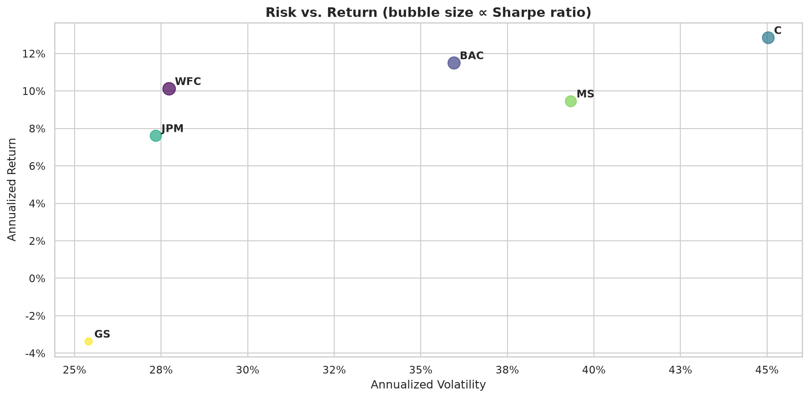
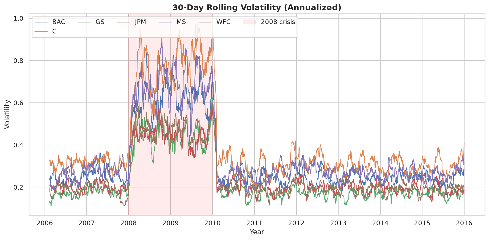
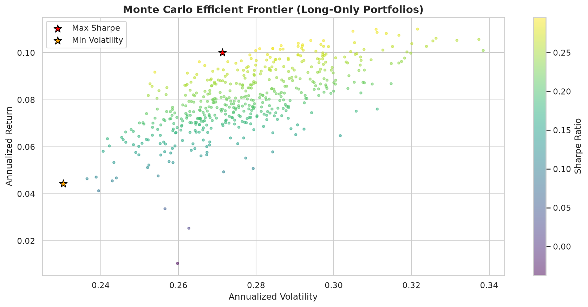

# 📈 Finance Stock Analysis using Python

Historical performance, risk and portfolio analysis of **six major U.S. banks
(2006–2016)** — returns, volatility, correlations, drawdowns and Monte Carlo
portfolios — in one tested Python codebase with three interfaces: a Jupyter
notebook, a headless CLI pipeline, and an interactive Streamlit dashboard.

| Bank | Ticker | Bank | Ticker |
|------|--------|------|--------|
| Bank of America | BAC | JPMorgan Chase | JPM |
| Citigroup | C | Morgan Stanley | MS |
| Goldman Sachs | GS | Wells Fargo | WFC |

---

## 🧩 Problem statement

Bank equity is unusually exposed to a single shared shock: the 2008–2009
financial crisis. For anyone learning quantitative analysis, the sector raises
practical questions that a single "average return" number cannot answer:

- How different were the six banks' risk-adjusted outcomes over the same decade?
- How deep were the losses, and how long did recovery take?
- Did the banks actually diversify each other, or did they move together?
- What does mixing them into a portfolio do to risk, given those correlations?

Answering these needs consistent return and risk definitions, a documented data
path, and reproducible numbers — not a one-off notebook cell.

## 🎯 Project objectives

1. Load a decade of daily prices reproducibly, and label the data source
   honestly (live download, cached snapshot, or simulated).
2. Implement the standard return and risk metrics with documented formulas
   (daily/cumulative returns, annualized return and volatility, Sharpe, Sortino,
   maximum drawdown, historical VaR/CVaR).
3. Quantify co-movement between the banks using daily-return correlations.
4. Explore portfolio combinations with a dependency-light Monte Carlo
   simulation, and state plainly what that simulation can and cannot claim.
5. Ship the analysis three ways (notebook, CLI, dashboard) over one shared
   `src/` package, with an offline test suite that needs no network.

---

## ✨ Features

- **Data layer** — Yahoo Finance download, validated CSV cache, layout-aware
  extraction, cleaning, and a deterministic synthetic fallback for offline use.
- **Returns** — simple daily returns, cumulative ("growth of $1") and
  normalized (base-100) series.
- **Risk** — annualized volatility, Sharpe and Sortino ratios, maximum
  drawdown, historical VaR/CVaR, rolling volatility, best/worst days.
- **Relationships** — Pearson correlation of daily returns, with a fixed −1…+1
  heatmap.
- **Portfolios** — random long-only Monte Carlo simulation, max-Sharpe and
  min-volatility selections, weight tables.
- **Dashboard** — dark Streamlit + Plotly UI in four tabs (Prices, Risk,
  Correlations, Portfolio) with KPI cards, interactive charts, formatted tables
  and CSV downloads.
- **Reproducibility** — fixed seeds, one config module, pinned dependency
  requirements, 96 offline tests.

---

## 🛠 Technologies

| Layer | Tools |
|-------|-------|
| Language | Python 3.10+ (developed and tested on 3.12) |
| Data | `pandas`, `numpy`, `yfinance` (Yahoo Finance) |
| Static charts (notebook/CLI) | `matplotlib`, `seaborn` |
| Dashboard | `streamlit`, `plotly` |
| Notebook | `jupyter`, `notebook` |
| Testing | `pytest`, `streamlit.testing.v1.AppTest` |

No database, no web framework, no ML library, and no paid API is required.

---

## 📁 Architecture

```text
finance-stock-analysis/
├── finance_project.ipynb      # Narrative analysis (imports src/)
├── app.py                     # Streamlit dashboard (imports src/)
├── scripts/run_analysis.py    # Headless pipeline: charts + CSVs + findings
├── src/
│   ├── config.py              # Tickers, dates, parameters, paths (single source of truth)
│   ├── data.py                # Download → extract → clean (or synthesize)
│   ├── metrics.py             # Pure functions: returns, risk, correlations
│   ├── portfolio.py           # Monte Carlo long-only portfolio simulation
│   ├── plots.py               # Matplotlib charts for the notebook / CLI (PNG output)
│   ├── charts.py              # Interactive Plotly builders for the dashboard
│   └── theme.py               # Dashboard design system: palette, CSS, KPI cards, Plotly template
├── .streamlit/config.toml     # Dark theme + categorical colours (mirrors src/theme.py)
├── tests/
│   ├── test_metrics.py        # 42 tests: financial maths + data layer
│   ├── test_theme.py          # 27 tests: palette, formatters, HTML escaping, Plotly template
│   ├── test_charts.py         # 16 tests: chart structure, colours, scales, empty input
│   └── test_app.py            # 11 tests: widgets, date filter, validation, downloads
├── screenshots/               # Local dashboard captures (not tracked in git)
├── data/                      # summary.csv, correlation.csv (price cache is git-ignored)
├── images/                    # Generated matplotlib charts
├── docs/                      # Full documentation (see below)
├── requirements.txt           # Core deps (notebook, CLI, data)
├── requirements-dev.txt       # + pytest, streamlit, plotly
├── CONTRIBUTING.md            # Contribution guidelines
└── CHANGELOG.md               # Version history
```

Design rules: every interface imports `src/` (no duplicated logic); `metrics`
and `portfolio` are pure and offline; `config.py` holds all constants. See
[docs/architecture.md](docs/architecture.md) for the data-flow diagram.

---

## 🚀 Installation and running

### 1. Setup

```bash
python3 -m venv .venv && source .venv/bin/activate   # Windows: .venv\Scripts\activate
pip install -r requirements.txt        # core: data, metrics, notebook, CLI
```

For the dashboard and the tests, install the dev extras instead — they include
the core requirements:

```bash
pip install -r requirements-dev.txt    # + pytest, streamlit, plotly
```

### 2a. Notebook (start here)

```bash
jupyter notebook finance_project.ipynb
```

Run all cells top to bottom. It loads live Yahoo data when online, otherwise
uses a reproducible synthetic dataset — and always prints which source was used.

### 2b. CLI pipeline (headless, reproducible)

```bash
# Cached or live data → charts in images/, CSVs in data/, findings in terminal
python scripts/run_analysis.py

# Fully offline demo with synthetic data
python scripts/run_analysis.py --synthetic --no-cache
```

### 2c. Dashboard

```bash
pip install -r requirements-dev.txt
streamlit run app.py
```

Opens on <http://localhost:8501>. Sidebar controls: bank selection, start/end
dates, risk-free rate, short/long moving-average windows, rolling-volatility
window and a synthetic-data toggle.

### 2d. Tests

```bash
pytest tests/ -q     # 96 passed, no network required
```

---

## 📥 Data and the six banks

| Item | Detail |
|------|--------|
| Universe | BAC, C, GS, JPM, MS, WFC — six large U.S. commercial / investment banks |
| Period | `2006-01-01` → `2016-01-01`, i.e. **2006-01-03 → 2015-12-31**, 2,517 trading days |
| Source | Yahoo Finance via `yfinance` (OHLCV, `auto_adjust=False`) |
| Price basis | **`Adj Close`** — dividend- and split-adjusted, so returns are total returns |
| Cache | `data/bank_prices.csv` (git-ignored), reused only when it covers the requested tickers and dates |

Yahoo Finance treats the end date as **exclusive**, which is why the default
`2016-01-01` range ends on 2015-12-31.

Every interface reports which of the three data provenances it used, so they are
never confused:

1. **`yahoo`** — live download in this session.
2. **`cache`** — the stored Yahoo Finance snapshot in `data/bank_prices.csv`.
3. **`synthetic`** — simulated prices from a fixed seed, for offline demos and
   tests. The dashboard shows a warning banner and a gold "Synthetic demo data"
   pill; synthetic and real prices are never mixed in one series.

> These prices are **loaded, not independently verified**. The project does no
> cross-checking against another market data provider, so the dashboard labels
> the status "Historical data loaded" rather than claiming verified prices.

---

## 📊 Financial methodology

All implementations live in `src/metrics.py` and `src/portfolio.py`; the
reasoning is in [docs/methodology.md](docs/methodology.md).

| Metric | Formula |
|--------|---------|
| Prices used | dividend/split-adjusted `Adj Close` (total return) |
| Daily return | `P_t / P_{t-1} − 1` (first row dropped; no implicit filling) |
| Annualized return | `mean(daily) × 252` — **arithmetic**, not CAGR |
| CAGR (reported separately where needed) | `(P_end / P_start)^(252 / n) − 1` |
| Annualized volatility | `std(daily, ddof=1) × √252` |
| Sharpe ratio | `(ann_return − r_f) / ann_vol` (both annualized on 252 days) |
| Sortino ratio | `(ann_return − r_f) / (√mean(min(r − r_f,daily, 0)²) × √252)` |
| Max drawdown | `min((P − running_max) / running_max)` |
| VaR 95% (daily return) | 5th percentile of daily returns (negative = loss) |
| CVaR / expected shortfall | mean of daily returns at or below the VaR quantile |
| Correlation | Pearson correlation of daily returns (pairwise complete observations) |
| Growth of $1 | `cumprod(1 + daily_returns)` |

Default risk-free rate is 2% per year. Because the annualized return is an
arithmetic mean, it is **not** the rate at which the investment actually
compounded: over this sample WFC's arithmetic annualized return is +19.2% while
its CAGR is +8.3%, and BAC's arithmetic figure is +8.6% while its CAGR is
−7.9%. Both are correct for their own definition; the tables label the
arithmetic figure as "annual mean return" for that reason.

### Portfolio simulation — what it is

`src/portfolio.py` draws random **long-only** weight vectors (weights ≥ 0,
normalised to sum to 100%) and evaluates each one with the sample mean vector
and covariance matrix of daily returns, annualized by 252 trading days.

- It reports the **maximum-Sharpe** and **minimum-volatility** portfolios *found
  among the sampled mixes*, and scatters all samples as a risk–return cloud.
- It is **not an optimised efficient frontier.** No solver, gradient or
  closed-form optimum is used, so the curve is only approximated and the two
  highlighted points are best-of-sample, not mathematically optimal.
- It is **descriptive, not predictive**: inputs are full-sample means and
  covariances, so the exercise contains look-ahead information, is not a
  backtest, and says nothing about future performance. Nothing here is
  investment advice.

---

## 📈 Key historical findings (cached Yahoo Finance data, 2006–2015)

From `data/summary.csv` and `data/correlation.csv` (regenerated from the cached
Yahoo `Adj Close` snapshot, 2,517 sessions, risk-free 2%):

| Bank | Ann. mean return | Ann. volatility | Sharpe | Sortino | Max drawdown |
|------|------------------|-----------------|--------|---------|--------------|
| WFC | +19.2% | 47.9% | 0.36 | 0.57 | −79.0% |
| JPM | +17.0% | 43.9% | 0.34 | 0.52 | −68.1% |
| MS | +13.9% | 59.9% | 0.20 | 0.32 | −87.1% |
| GS | +12.5% | 40.3% | 0.26 | 0.39 | −78.8% |
| BAC | +8.6% | 58.2% | 0.11 | 0.17 | −93.4% |
| C | −2.5% | 61.4% | −0.07 | −0.11 | −98.0% |

- **Citigroup (C)** was the most volatile bank (61.4% annualized), lost the most
  from its peak (−98.0%) and was the only one with a negative annualized mean
  return over the window.
- **Goldman Sachs (GS)** was the calmest (40.3% annualized volatility).
- **BAC–WFC** had the strongest positive correlation (**0.83**); **MS–WFC** the
  weakest (**0.60**); the average pairwise correlation was **0.72**.
- Volatility and drawdowns spiked across all six banks in **2008–2009**, and the
  sector's high internal correlation means diversification *within* it is
  limited.

These are descriptive statistics for one historical window on one data source.
They are not forecasts, and a different sample period would give different
numbers. The values above are rounded; the CSVs hold full precision.

> `images/` was rendered by the offline synthetic demo so the files are
> identical on every machine; `data/*.csv` holds the cached Yahoo snapshot. Run
> the notebook or CLI with internet access to regenerate charts from live data.

---

## 🖥️ Dashboard (v2.3 design)

A dark, institutional-style dashboard built with Streamlit + Plotly. Every chart
is interactive (hover, zoom, pan) and the four tabs share one design system.

| Tab | What it shows |
|-----|---------------|
| **Prices** | Per-bank KPI cards (total return, volatility, Sharpe), adjusted closes with the 2008–09 crisis band and optional log axis, normalized performance, growth of $1, moving averages and daily-return bars for a focus bank, price table + CSV |
| **Risk** | Headline risk cards, formatted metrics table (annual return/volatility, Sharpe, Sortino, max drawdown, VaR 95%, best/worst day, growth of $1) with per-column definitions, risk-vs-return scatter, underwater drawdown, rolling volatility, return distributions, best/worst days |
| **Correlations** | Heatmap fixed to −1…+1, average/strongest/weakest-pair cards, matrix table + CSV, and a plain-English interpretation noting correlation is not causation |
| **Portfolio** | Monte Carlo risk-vs-return cloud coloured by Sharpe, max-Sharpe and min-volatility allocations with percentage weights, allocation table + CSV, and an expander explaining the method's limits |

Design and UX details:

- **One ticker = one colour + one marker shape** everywhere (`src/theme.py`), so
  colour is never the only way to tell series apart.
- Data provenance is always visible: a status pill (live / cached CSV /
  synthetic), source, price-basis and status chips, the real date span and the
  trading-day count.
- Empty and error states are written for humans (single-bank portfolio, invalid
  date range, identical moving-average windows); technical details stay inside a
  "Diagnostics" expander.
- Tables use typed column formats (`%`, `$`, dates) and each has a CSV download.
- Results are cached per (tickers, dates, source) and per metric bundle, so
  moving a slider does not re-download data.

### Seeing it

```bash
streamlit run app.py
```

The four tabs share one dark layout: Prices (KPI cards, adjusted closes with the
crisis band, normalized and growth-of-$1 lines, moving averages, daily-return
bars), Risk (metric cards and table, risk-vs-return scatter, underwater
drawdown, rolling volatility, return distributions), Correlations (fixed −1…+1
heatmap, pair cards, matrix table, interpretation panel) and Portfolio (Monte
Carlo cloud with the two highlighted allocations and a weights table).

> Dashboard screenshots are **not** part of this repository: the images in the
> local `screenshots/` folder were captured during the Phase 2 redesign and still
> show the old header status chip ("Verified market prices"), which has since
> been replaced by the factual labels "Cached historical data" / "Historical
> data loaded" (prices are loaded from Yahoo Finance, not independently
> verified). The chart images under `images/` below are committed and current
> apart from the portfolio chart title, which is now "Monte Carlo Risk-Return
> Cloud".

---

## 📷 Sample visualizations (matplotlib, notebook / CLI)

### Risk vs. return (bubble size ∝ Sharpe ratio)



### Correlation heatmap


### 30-day rolling volatility (annualized)



### Drawdown from peak


### Monte Carlo risk–return cloud



### BAC with 30/50-day moving averages


---

## ⚠️ Limitations

1. **Single sample window.** 2006–2015 includes the financial crisis; results are
   descriptive for that period only and will differ in other windows.
2. **Survivorship bias.** All six banks survived 2008. Failed or merged peers
   (Lehman Brothers, Bear Stearns, Washington Mutual) are absent, which flatters
   the sector.
3. **One data source, not independently verified.** Prices come from Yahoo
   Finance; the project does not cross-check them against another provider.
   Yahoo may restate historical prices.
4. **Arithmetic annualization.** `mean(daily) × 252` is not the compounded
   growth rate; CAGR is reported separately where it matters.
5. **Historical VaR.** VaR/CVaR are empirical quantiles of one sample, so they
   say nothing about losses larger than any observed day.
6. **Look-ahead in the portfolio tab.** Weights use full-sample means and
   covariances; the simulation is illustrative, not a backtest and not a
   recommendation.
7. **Correlation is unstable.** Relationships strengthen in crises — exactly
   when diversification is needed most.
8. **Gap filling.** `clean_prices()` forward/back-fills gaps of up to five
   trading days, so a few prices are carried over rather than observed.
9. **Synthetic fallback.** When downloads fail the app switches to simulated
   data; it is always labelled, but it is not market data.

---

## 🔮 Future improvements

- [ ] CAPM beta vs. an S&P 500 benchmark
- [ ] Constrained portfolio optimization (scipy) with target return / max weight
- [ ] Regime detection (bull / bear / crisis clustering)
- [ ] Independent data cross-check (a second provider) before any "verified" label
- [x] Dividend- and split-adjusted total-return analysis (`Adj Close`, default since Phase 1)

The project is **not** a stock-prediction or ML system, and adding forecasting
is deliberately out of scope for its current release.

---

## 📚 Documentation

Full guides live in [`docs/`](docs/README.md):

- [Getting Started](docs/getting-started.md) — install & first run
- [User Guide](docs/user-guide.md) — notebook, dashboard, and `src/` as a library
- [CLI Reference](docs/cli-reference.md) — every pipeline option + outputs
- [Methodology](docs/methodology.md) — formulas, assumptions, limitations
- [Data](docs/data.md) — sources, caching, schemas, synthetic fallback
- [API Reference](docs/api-reference.md) — every public `src/` function
- [Architecture](docs/architecture.md) — structure + data-flow diagram
- [Findings](docs/findings.md) — results and how to reproduce them
- [Troubleshooting](docs/troubleshooting.md) — FAQ and fixes

Also see [CONTRIBUTING](CONTRIBUTING.md) and [CHANGELOG](CHANGELOG.md).

---

## 🎓 Learning outcomes

- Working with real market data, including caching, API quirks and offline fallback
- Return and risk measurement with explicit, testable formulas
- Correlation analysis and portfolio intuition — and its limits
- Structuring analysis into pure, reusable modules instead of one notebook
- Reproducible pipelines, an offline test suite, and an interactive dashboard

---

## 👩‍💻 Author

**Vanshika Rathore** — B.Tech Computer Science Engineering (AI & ML)

GitHub: https://github.com/vanshi13rathore

## ⭐ If you found this project useful, consider giving it a Star!
