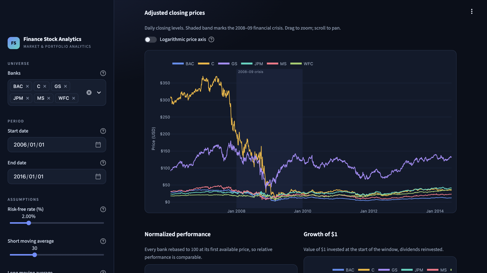
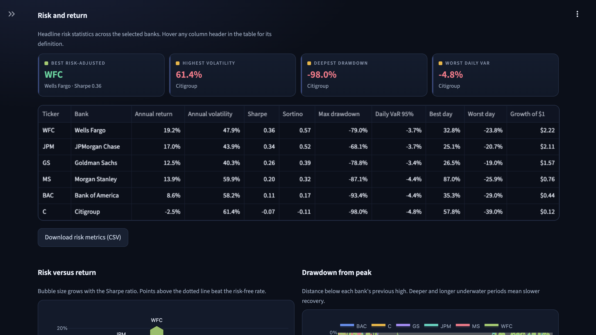
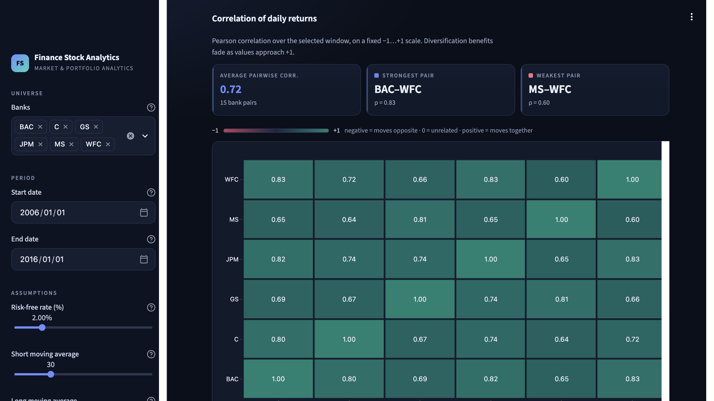
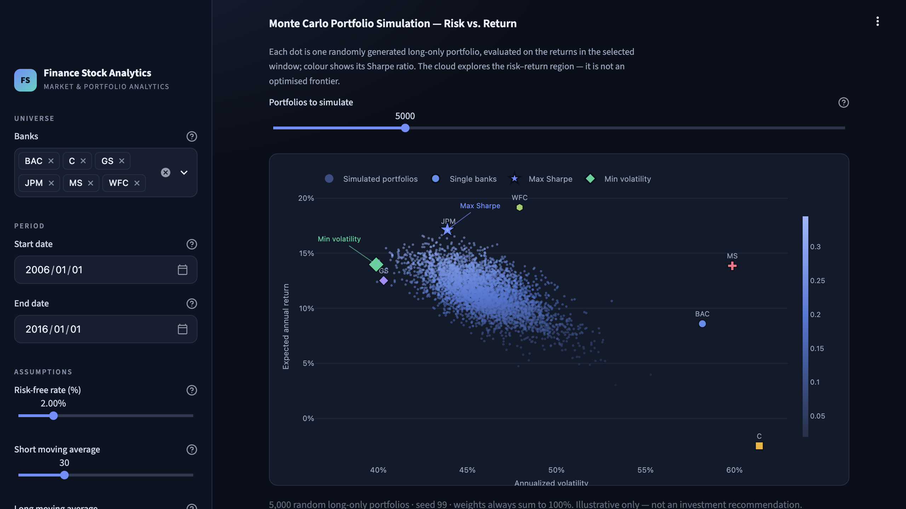
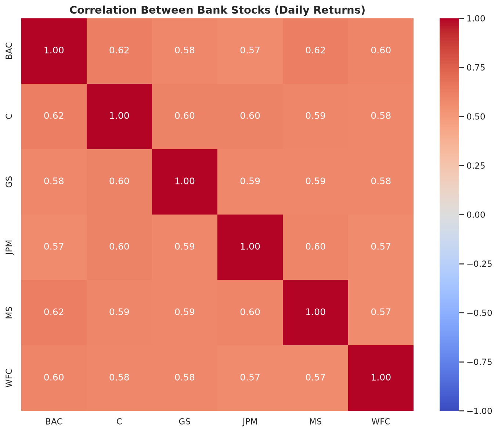
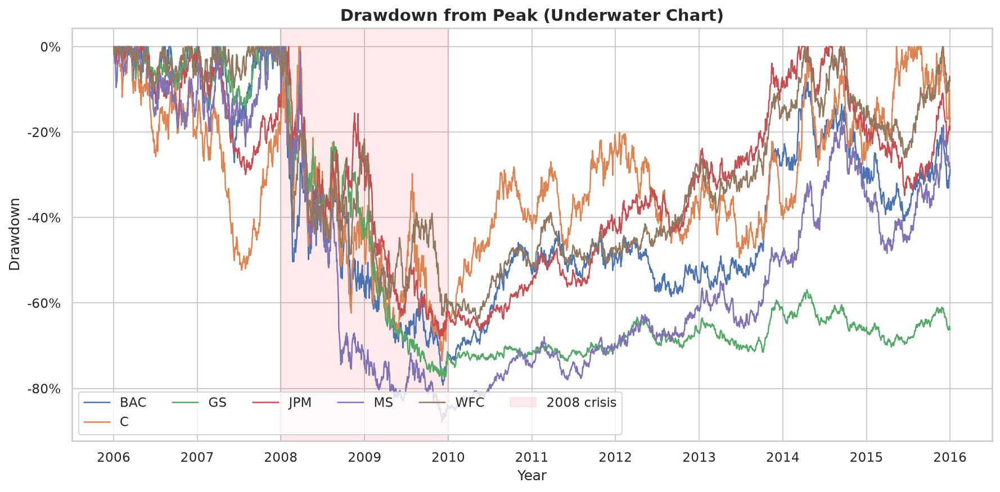
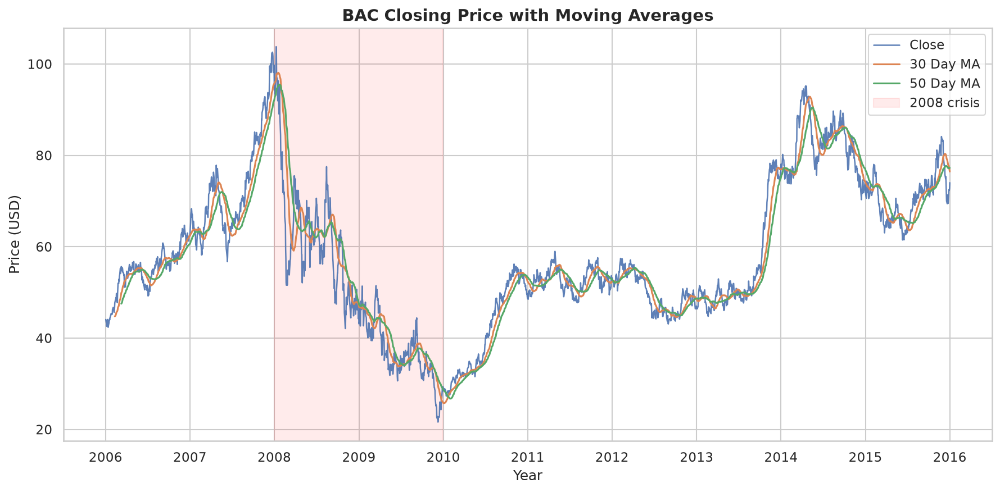

# 📈 Finance Stock Analytics Dashboard

**Historical risk-and-return analysis of six major U.S. banks (2006–2015)** —
prices, returns, risk metrics, correlations, trend analysis and a Monte Carlo
portfolio simulation, shipped as a Jupyter notebook, a headless CLI pipeline and
an interactive Streamlit dashboard.

<p>
  
  
  
</p>

> This is an **analytics** project on historical market data. It is **not** an
> AI/ML forecasting system, not a trading bot, and its outputs are **not**
> investment advice.

## 🔗 Project links

| | |
|---|---|
| **Repository** | https://github.com/vanshi13rathore/finance-stock-analytics-dashboard |
| **Live demo** | https://finance-stock-analytics-dashboard-2bvus3d62aipv2dxgvwvp8.streamlit.app/ |
| **Documentation** | [`docs/index.md`](docs/index.md) — index of every guide and reference |
| **License** | [MIT](LICENSE) |

## 🎯 What this project does

It answers a narrow, well-defined question: *how did six large U.S. banks behave
as investments over the decade that contains the 2008 financial crisis?* The
answers are computed from daily adjusted closing prices and presented through a
notebook, a CLI pipeline and a Streamlit dashboard.

| Area | What it covers |
|------|----------------|
| **Returns** | Daily, cumulative, normalized, growth of \$1 |
| **Risk** | Annualized volatility, maximum drawdown, historical VaR / CVaR |
| **Risk-adjusted performance** | Sharpe and Sortino ratios (252-day annualization, 2% risk-free rate) |
| **Relationships** | Pearson correlation matrix, average / strongest / weakest pairs |
| **Trends** | 30- and 50-day moving averages, rolling volatility, best and worst days |
| **Portfolios** | Monte Carlo cloud of 5,000 random long-only portfolios, max-Sharpe and min-volatility markers |

## 🧩 Problem statement

Bank equity is unusually exposed to a single shared shock: the 2008–2009
financial crisis. For anyone learning quantitative analysis, the sector raises
practical questions that one "average return" cannot answer:

- How different were the six banks' risk-adjusted outcomes over the same decade?
- How deep were the losses, and how long did recovery take?
- Did the banks actually diversify each other, or did they move together?
- What does mixing them into a portfolio do to risk, given those correlations?

Answering them needs consistent return and risk definitions, a documented data
path and reproducible numbers — not a one-off notebook cell.

## 🎯 Project objectives

1. Load a decade of daily prices reproducibly and label the data source honestly
   (live download, cached snapshot or simulated).
2. Implement the standard return and risk metrics with documented formulas:
   daily/cumulative returns, annualized return and volatility, Sharpe, Sortino,
   maximum drawdown and historical VaR/CVaR.
3. Quantify co-movement between the banks using daily-return correlations.
4. Explore portfolio combinations with a dependency-light Monte Carlo
   simulation, stating plainly what that simulation can and cannot claim.
5. Ship the analysis three ways (notebook, CLI, dashboard) over one shared `src/`
   package, with an offline test suite that needs no network.

## 🧱 Technology stack

| Layer | Tools |
|-------|-------|
| Language | Python 3.12 (3.10+ supported) |
| Data | `pandas`, `numpy`, `yfinance` (Yahoo Finance) |
| Notebook / static charts | `matplotlib`, `seaborn`, Jupyter |
| Dashboard | `streamlit`, `plotly` |
| Testing | `pytest` (112 offline tests) |
| Deployment | Streamlit Community Cloud |

## ✨ Key features

- **One analysis core, three interfaces** — the notebook, the CLI and the
  dashboard all call the same `src/` modules; no logic is duplicated.
- **Honest data provenance** — every run reports whether prices came from a live
  Yahoo download (`Historical data loaded`), the stored CSV snapshot (`Cached
  historical data`) or the synthetic demo generator (`Simulated — not market
  data`). Prices are *loaded*, never claimed to be independently verified.
- **Offline-safe and reproducible** — a deterministic synthetic dataset (fixed
  seed `99`) keeps tests and demos working with no internet access.
- **Tested financial maths** — 112 offline tests cover returns, risk metrics,
  data cleaning, chart contracts and the dashboard itself.
- **Fail-safe dashboard** — network failures degrade to a clearly labelled
  synthetic dataset instead of crashing, with technical details behind a
  diagnostics expander.

## 📷 Dashboard screenshots

Captured from the Streamlit app running on the cached Yahoo Finance snapshot
(2006–2015, 2,517 sessions, `Adj Close` basis).

### Prices



KPI cards with total return, volatility and Sharpe per bank, above the adjusted
closing price history with the 2008–09 crisis shaded.

### Risk



Headline risk cards — best risk-adjusted, highest volatility, deepest drawdown,
worst daily VaR — above the full per-bank metrics table (annualized return and
volatility, Sharpe, Sortino, max drawdown, VaR, best/worst day, growth of \$1).

### Correlations



Average pairwise correlation (0.72), strongest pair (BAC–WFC, ρ = 0.83) and
weakest (MS–WFC, ρ = 0.60), above the full daily-return correlation matrix.

### Portfolio



Monte Carlo cloud of 5,000 randomly generated long-only portfolios, coloured by
Sharpe ratio, with the maximum-Sharpe and minimum-volatility **sampled** mixes
marked. It explores the risk–return region; it is not an optimised frontier.

## 📉 Sample visualizations (Matplotlib — notebook / CLI)

Static figures written to `images/` by the notebook or `scripts/run_analysis.py`.
Unlike the four interactive dashboard screenshots above, these are flat PNGs
produced by the same analysis core — regenerate them with
`python scripts/run_analysis.py`. The committed versions were rendered from the
deterministic synthetic demo, so they are identical on every machine; re-run the
pipeline to redraw them from cached or live Yahoo Finance prices.

| Figure | Figure |
|--------|--------|
| <br>**Risk vs. return** — bubble size ∝ Sharpe ratio. | <br>**Correlation heatmap** — daily-return correlations. |
| <br>**30-day rolling volatility**, annualized. | <br>**Drawdown from peak** — the underwater curve. |
| <br>**Sampled portfolio cloud** — random long-only mixes, *not* a solved efficient frontier (the output file keeps its legacy name). | <br>**BAC with 30/50-day moving averages.** |

## 🚀 Installation

Requires **Python 3.10+** (developed and tested on 3.12).

```bash
git clone https://github.com/vanshi13rathore/finance-stock-analytics-dashboard.git
cd finance-stock-analytics-dashboard
python3 -m venv .venv && source .venv/bin/activate   # Windows: .venv\Scripts\activate
pip install -r requirements.txt
```

`requirements.txt` covers the notebook, CLI **and** dashboard (it declares
`streamlit` and `plotly`). For the test suite as well, install the dev extras
instead:

```bash
pip install -r requirements-dev.txt   # requirements.txt + pytest
```

## ▶️ Running locally

### Dashboard (recommended)

```bash
streamlit run app.py
```

Opens <http://localhost:8501> with four tabs — **Prices**, **Risk**,
**Correlations**, **Portfolio** — plus sidebar controls for tickers, dates,
risk-free rate, moving-average windows, rolling-volatility window and a synthetic
data toggle.

### CLI pipeline (reproducible, headless)

```bash
python scripts/run_analysis.py                          # cached or live data
python scripts/run_analysis.py --synthetic --no-cache   # fully offline demo
```

Writes charts to `images/` and CSVs to `data/`; see the
[CLI Reference](docs/cli-reference.md) for every option.

### Notebook (exploratory)

```bash
jupyter notebook finance_project.ipynb
```

### Tests

```bash
pytest tests/ -q   # 112 passed, no network required
```

## 🏗 Architecture

```text
finance-stock-analytics-dashboard/
├── app.py                  # Streamlit dashboard (four tabs)
├── finance_project.ipynb   # narrative analysis notebook
├── scripts/run_analysis.py # headless end-to-end pipeline
├── src/
│   ├── config.py           # tickers, dates, parameters, paths
│   ├── data.py             # download → cache → clean → synthetic fallback
│   ├── metrics.py          # returns, risk, correlation (pure functions)
│   ├── portfolio.py        # Monte Carlo long-only portfolio simulation
│   ├── plots.py            # matplotlib charts (notebook / CLI)
│   ├── charts.py           # Plotly figures (dashboard)
│   └── theme.py            # dashboard design system
├── tests/                  # 112 offline tests
├── data/                   # summary.csv, correlation.csv (+ git-ignored cache)
├── images/                 # generated chart PNGs
├── screenshots/            # dashboard screenshots used above
└── docs/                   # documentation
```

The notebook, CLI and dashboard are thin layers over `src/`; `metrics` and
`portfolio` are pure (no network, no plotting). Full detail, including the data
flow diagram and dependency graph, is in
[Architecture](docs/architecture.md).

## 📊 Financial metrics and analysis performed

| Metric | Definition |
|--------|------------|
| Daily / cumulative returns | `P_t / P_{t-1} − 1`, compounded to a growth series |
| Normalized prices | Each ticker rebased to 100 at its first valid price |
| Annualized return | `mean(daily) × 252` — **arithmetic, not CAGR** |
| Annualized volatility | `std(daily, ddof=1) × √252` |
| Sharpe ratio | `(ann. return − r_f) / ann. vol` |
| Sortino ratio | Excess return over downside deviation against the target |
| Maximum drawdown | Worst peak-to-trough decline |
| VaR 95% / CVaR | 5th percentile of daily returns, and the mean of days beyond it |
| Correlation | Pearson correlation of daily returns, pairwise complete |
| Rolling volatility | 30-day rolling std of returns, annualized |
| Portfolio performance | `w·μ×252`, `√(wᵀΣw)×√252`, and the resulting Sharpe |

Formulas, worked examples and edge cases: [Metrics Reference](docs/metrics-reference.md).
Constrained optimisation is deliberately **not** implemented — see
[Portfolio Simulation](docs/portfolio-simulation.md).

## 📥 Data and historical range

| Item | Detail |
|------|--------|
| Universe | `BAC`, `C`, `GS`, `JPM`, `MS`, `WFC` (Bank of America, Citigroup, Goldman Sachs, JPMorgan Chase, Morgan Stanley, Wells Fargo) |
| Period | `2006-01-01` → `2016-01-01`, i.e. **2006-01-03 → 2015-12-31**, 2,517 trading days |
| Source | Yahoo Finance via `yfinance` (OHLCV, `auto_adjust=False`) |
| Price basis | **`Adj Close`** — dividend- and split-adjusted, so returns are total returns |
| Cache | `data/bank_prices.csv` (git-ignored), reused only when it covers the requested tickers and dates |
| Fallback | Deterministic synthetic prices (seed `99`), always labelled as simulated |

Yahoo treats the end date as **exclusive**, which is why the default range ends
on 2015-12-31. The dashboard's date pickers support any window that Yahoo can
serve, but every figure documented here describes the 2006–2015 default. Details,
schemas and cleaning rules: [Data & Sources](docs/data-and-sources.md).

## 📈 Headline historical findings (2006–2015)

| Bank | Ann. mean return | Ann. volatility | Sharpe | Sortino | Max drawdown |
|------|------------------|-----------------|--------|---------|--------------|
| WFC | +19.2% | 47.9% | 0.36 | 0.57 | −79.0% |
| JPM | +17.0% | 43.9% | 0.34 | 0.52 | −68.1% |
| MS | +13.9% | 59.9% | 0.20 | 0.32 | −87.1% |
| GS | +12.5% | 40.3% | 0.26 | 0.39 | −78.8% |
| BAC | +8.6% | 58.2% | 0.11 | 0.17 | −93.4% |
| C | −2.5% | 61.4% | −0.07 | −0.11 | −98.0% |

- **Citigroup** was the most volatile (61.4%), lost the most from its peak
  (−98.0%) and was the only bank with a negative annualized mean return.
- **Goldman Sachs** was the calmest (40.3% annualized volatility).
- **BAC–WFC** was the strongest pair (ρ = 0.83); **MS–WFC** the weakest
  (ρ = 0.60); average pairwise correlation **0.72** — within-sector
  diversification is limited.
- Volatility and drawdowns spiked across all six banks in **2008–2009**.

Rounded values from `data/summary.csv` and `data/correlation.csv` (cached Yahoo
snapshot, risk-free 2%). Interpretation and reproduction steps:
[Findings](docs/findings.md).

## ⚠️ Assumptions and limitations

1. **Single sample window** — 2006–2015 includes the crisis; results describe that
   period only and will differ in other windows.
2. **Survivorship bias** — all six banks survived 2008; failed or merged peers
   (Lehman, Bear Stearns, Washington Mutual) are absent.
3. **One data source, not independently verified** — Yahoo Finance only; Yahoo may
   restate historical prices.
4. **Arithmetic annualization** — `mean(daily) × 252` is not CAGR (WFC: +19.2%
   arithmetic vs. +8.3% CAGR); the two are labelled separately.
5. **Historical VaR** — empirical quantiles of one sample, blind to losses larger
   than any observed day.
6. **Gap filling** — gaps of up to five trading days are forward/back-filled, so a
   few prices are carried values rather than observations.
7. **Look-ahead in the portfolio tab** — weights use full-sample means and
   covariances; the simulation is descriptive, not a backtest.
8. **Synthetic fallback is not market data** — it is always labelled as simulated.
9. **Correlation is unstable** — relationships strengthen in crises, exactly when
   diversification is needed most.
10. **Not investment advice** — an educational analysis of historical data.

## 🔮 Future improvements

- [ ] **CAPM beta vs. an S&P 500 benchmark** — measure systematic risk against
  the market.
- [ ] **Constrained portfolio optimisation with SciPy** — target return and
  maximum weight, replacing random sampling.
- [ ] **Regime detection** (bull / bear / crisis clustering).
- [ ] **Independent data cross-check** — a second price provider with a tolerance
  check, required before anything is labelled "verified".
- [x] **Dividend- and split-adjusted total-return analysis** (`Adj Close`, the
  default since Phase 1).

None of the unchecked items is implemented in the current release: this project
still performs historical analysis only and does not forecast prices.

## 🧪 Testing

```bash
pytest tests/ -q
```

**112 tests, no network access required**, all passing. They run against fixtures
and fixed-seed synthetic prices.

| Test file | Tests | Coverage |
|-----------|-------|----------|
| `tests/test_metrics.py` | 57 | Financial maths, data loading, cleaning, provenance |
| `tests/test_theme.py` | 27 | Palette, formatters, HTML escaping, Plotly template |
| `tests/test_charts.py` | 16 | Chart structure, colours, scales, empty input |
| `tests/test_app.py` | 12 | Dashboard widgets, date filter, validation, downloads |

## 📚 Documentation

Full guides and references live in [`docs/`](docs/index.md):

| Document | Contents |
|----------|----------|
| [Getting Started](docs/getting-started.md) | Install and run your first analysis |
| [User Guide](docs/user-guide.md) | Notebook, dashboard, and `src/` as a library |
| [Metrics Reference](docs/metrics-reference.md) | Formulas, conventions, limitations |
| [Portfolio Simulation](docs/portfolio-simulation.md) | Monte Carlo method, maths, assumptions |
| [Data & Sources](docs/data-and-sources.md) | Provenance, cache, synthetic fallback, schemas |
| [Findings](docs/findings.md) | Results and how to reproduce them |
| [Architecture](docs/architecture.md) | Layout, data flow, dependencies |
| [API Reference](docs/api-reference.md) | Public functions and constants |
| [CLI Reference](docs/cli-reference.md) | Pipeline options, outputs, exit codes |
| [Troubleshooting](docs/troubleshooting.md) | Common problems and fixes |

## 🎓 Learning outcomes

- Working with real market data, including caching, API quirks and an offline
  fallback.
- Return and risk measurement with explicit, testable formulas.
- Correlation analysis and portfolio intuition — and its limits.
- Structuring analysis into pure, reusable modules instead of one notebook.
- Reproducible pipelines, an offline test suite and an interactive dashboard.

## 🤝 Contributing

Contributions are welcome — see [CONTRIBUTING.md](CONTRIBUTING.md) for the
development setup, code guidelines and test requirements. Version history is in
[CHANGELOG.md](CHANGELOG.md).

## 📄 License

Released under the [MIT License](LICENSE) © 2026 Vanshika Rathore.

## 👩‍💻 Author

**Vanshika Rathore** — B.Tech Computer Science Engineering (AI & ML)
GitHub: https://github.com/vanshi13rathore

If you found this project useful, consider starring the repository. ⭐
