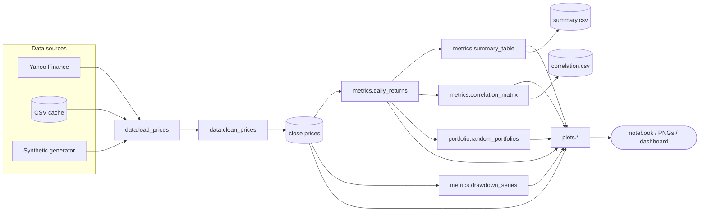

# 🏗️ Architecture

How the project fits together.

## Structure

```text
finance_project.ipynb      # narrative analysis (imports src/*)
app.py                     # Streamlit dashboard (imports src/*)
scripts/run_analysis.py    # headless pipeline (imports src/*)
src/
  config.py                # constants: tickers, dates, params, paths
  data.py                  # download → extract → clean (or synthesize)
  metrics.py               # pure functions: returns → risk tables
  plots.py                 # pure-ish: tables → matplotlib figures (notebook/CLI)
  charts.py                # tables → interactive Plotly figures (dashboard)
  theme.py                 # dashboard design system (palette, CSS, Plotly template)
  portfolio.py             # Monte Carlo long-only portfolio simulation
tests/                     # 112 offline tests
  test_metrics.py          # financial maths + data layer
  test_charts.py           # Plotly chart contracts
  test_theme.py            # palette, formatters, escaping, template
  test_app.py              # Streamlit AppTest: widgets, validation, downloads
data/                      # summary.csv, correlation.csv (+ git-ignored cache)
images/                    # generated chart PNGs
screenshots/               # local dashboard captures (not tracked)
docs/                      # you are here
```

Design rules:

1. **All interfaces share `src/`** — the notebook, CLI, and dashboard never
   reimplement logic; they only wire inputs to outputs.
2. **`metrics` and `portfolio` are pure** — no network, no plotting, no global
   state — so they're trivially testable (`pytest tests/` needs no internet).
3. **Config lives in one place** — `src/config.py` is imported everywhere;
   nothing hard-codes tickers, dates, or window sizes.
4. **Plots are functions, not scripts** — each returns `(fig, ax)` and
   optionally saves, so the same chart renders inline, to PNG, or in Streamlit.

## Data flow



## Dependency graph

```text
config ─┬─▶ data ─────▶ metrics ─┬─▶ plots
        │                         │
        └─▶ portfolio ◀───────────┘
```

- `config` depends on nothing (stdlib only).
- `data` needs `config` (+ `pandas`/`numpy`). `yfinance` is a **lazy import**
  inside `download_prices()`, so merely importing `src.data` never touches the
  network.
- `metrics` and `portfolio` need only `pandas`/`numpy`.
- `plots` needs `matplotlib`/`seaborn` (+ `pandas` for the crisis shading).
- `charts` and `theme` need `plotly` (+ `pandas`); they compute no financial
  metrics and never download data, so the dashboard stays a thin layer over
  `metrics` / `portfolio`.
